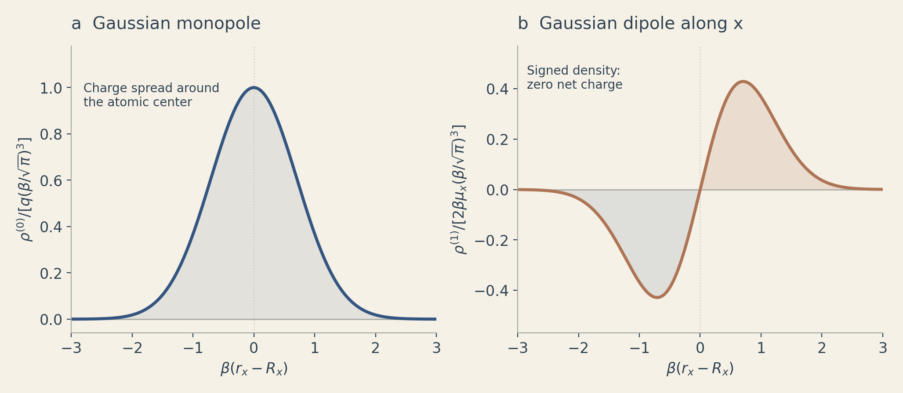
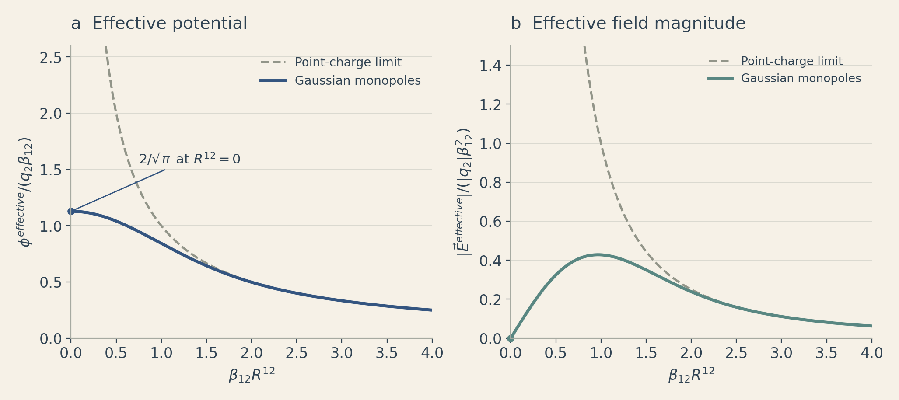
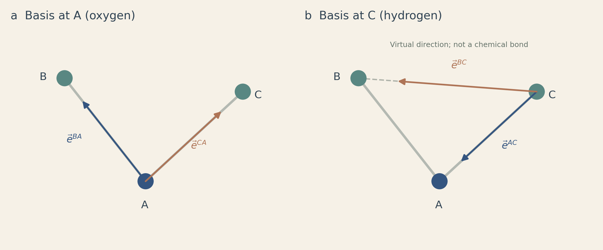

The **polarizable Gaussian Multipole (pGM) model** combines distributed atomic
charges, covalent dipoles, and induced dipoles. This note follows
[Wei et al. (2020)][wei], using the paper's notation and equation numbers.
We first consider a finite, nonperiodic system.

The logic is:

**charge distribution → pair interaction → effective field → induced dipoles
→ energy and forces.**

## 1. Gaussian monopoles and dipoles

Wei represents a monopole and a dipole centered at $\vec R$ as


\[
\begin{aligned}
\rho^{(0)}(\vec r;\vec R)
&=q\left(\frac{\beta}{\sqrt\pi}\right)^3
  \exp\!\left(-\beta^2|\vec r-\vec R|^2\right),\\
\rho^{(1)}(\vec r;\vec R)
&=\vec\mu\cdot\nabla_R
  \left(\frac{\beta}{\sqrt\pi}\right)^3
  \exp\!\left(-\beta^2|\vec r-\vec R|^2\right).
\end{aligned}
\tag{2}
\]


The Gaussian factor integrates to one, so the monopole has charge $q$.
The dipole density has zero net charge and first moment $\vec\mu$.
The Gaussian radius is $1/\beta$: decreasing $\beta$ spreads the distribution.
The gradient $\nabla_R$ acts on the atomic center $\vec R$.

In the polarizable model, $q_i$ and $\vec\mu_i$ are the covalent charge and
dipole on atom $i$, while $\vec p_i$ is its induced dipole. The combined dipole
is written explicitly as $\vec\mu_i+\vec p_i$.

*Figure 1. Analytical cross-sections of Eq. (2). The dipole is along the
Cartesian x direction. Each density is divided by the scale shown on its
vertical axis; the curves illustrate the functional form.*

## 2. Pair interactions and effective fields

For atoms 1 and 2, Wei defines


\[
\beta_{12}=\frac{\beta_1\beta_2}
 {\sqrt{\beta_1^2+\beta_2^2}},
\qquad R^{12}=|\vec R_1-\vec R_2|.
\tag{6}
\]


The three pair interactions are


\[
q_1q_2\frac{\operatorname{erf}(\beta_{12}R^{12})}{R^{12}},
\tag{3}
\]
\[
q_1\vec\mu_2\cdot\nabla_2
\frac{\operatorname{erf}(\beta_{12}R^{12})}{R^{12}},
\tag{4}
\]
\[
(\vec\mu_1\cdot\nabla_1)(\vec\mu_2\cdot\nabla_2)
\frac{\operatorname{erf}(\beta_{12}R^{12})}{R^{12}}.
\tag{5}
\]


These are the monopole–monopole, monopole–dipole, and dipole–dipole terms.
Electrostatic conversion constants are suppressed. Following Wei's operator
convention, a gradient paired with a dipole differentiates the coordinate
expression that follows, holding that dipole fixed during the operation.

The common factor approaches $1/R^{12}$ at large separation and
$2\beta_{12}/\sqrt\pi$ at zero separation. The finite short-range value comes
from integrating over the two distributed charge densities.

To express the interaction as a response to a field at atom 1, Wei introduces


\[
\begin{aligned}
\phi^{effective}
&=(q_2+\vec\mu_2\cdot\nabla_2)
  \frac{\operatorname{erf}(\beta_{12}R^{12})}{R^{12}},\\
\vec E^{effective}
&=-(q_2+\vec\mu_2\cdot\nabla_2)\nabla_1
  \frac{\operatorname{erf}(\beta_{12}R^{12})}{R^{12}}.
\end{aligned}
\tag{7}
\]


Both atomic widths enter this **effective** potential and field. The real
potential generated by atom 2 instead uses its source width alone:


\[
\phi^{real}=(q_2+\vec\mu_2\cdot\nabla_2)
\frac{\operatorname{erf}(\beta_2R^{12})}{R^{12}}.
\tag{8}
\]


*Figure 2. Eq. (7) for a monopole source, $\vec\mu_2=0$.
The potential and field magnitude are scaled by $q_2\beta_{12}$ and
$|q_2|\beta_{12}^2$, respectively. The abscissa is $\beta_{12}R^{12}$.
The effective field magnitude vanishes at coincident centers and approaches
the point-charge result at large separation.*

## 3. Induced dipoles must be self-consistent

Wei's polarization relation is


\[
\begin{aligned}
\vec p_i&=\alpha_i\vec E_i^{effective}\\
&=\alpha_i\left(\vec E_i^{covalent,effective}
       -\sum_{j\ne i}\vec{\vec T}_{ij}\cdot\vec p_j\right),\\
\vec E_i^{covalent,effective}
&=-\sum_{j\ne i}(q_j+\vec\mu_j\cdot\nabla_j)\nabla_i
  \frac{\operatorname{erf}(\beta_{ij}R^{ij})}{R^{ij}},\\
\vec{\vec T}_{ij}&=\nabla_i\nabla_j
  \frac{\operatorname{erf}(\beta_{ij}R^{ij})}{R^{ij}}.
\end{aligned}
\tag{10}
\]


Here $\alpha_i$ is the atomic polarizability, and $\vec{\vec T}_{ij}$ is the
dipole–dipole interaction tensor. Its mixed-derivative definition determines
the minus sign in the induced field. Each $\vec p_i$ changes the fields driving
the other dipoles, so evaluating only
$\alpha_i\vec E_i^{covalent,effective}$ misses their mutual response.
All induced dipoles must satisfy Eq. (10) together.

Following Wei, we now omit the superscript *effective* in the energy and
force discussion. Thus $\vec E_i^{covalent}$ still denotes an effective field,
and $\vec E_i$ includes both covalent and induced contributions.
Gaussian screening removes the point-dipole singularity; stable polarization
also depends on the chosen widths and polarizabilities ([Elking et al.][elking]).

## 4. Covalent dipoles follow the molecular geometry

Wei also writes a covalent dipole as $\vec u$ when expressing it in a
**covalent basis vector (CBV) frame**. This is the same permanent dipole
represented by $\vec\mu$ above. For one atom,


\[
\nabla(\vec u)
=\nabla\left(\sum_i u_i\frac{\vec R_i}{|\vec R_i|}\right)
=\sum_i u_i\left(
 \frac{\vec{\vec I}}{|\vec R_i|}
 -\frac{\vec R_i\vec R_i}{|\vec R_i|^3}\right).
\tag{9}
\]


In this local expression, $\vec R_i$ points from the atom whose dipole is
being defined to its ith covalently interacting neighbor, including virtual
neighbors. The $u_i$ are fixed coefficients, and $\vec{\vec I}$ is the identity
tensor. This local use of $\vec R_i$ follows Wei's Eq. (9); elsewhere,
$\vec R_i$ denotes an atomic position.

*Figure 3. A is oxygen; B and C are hydrogens, as in Wei's Fig. 1.
At A, the basis vectors are $\vec e^{BA}$ and $\vec e^{CA}$.
At C, they are $\vec e^{AC}$ and $\vec e^{BC}$.
The second superscript identifies the origin: $\vec e^{BA}$ points from A
toward B. The dashed C–B segment defines a virtual direction. Geometry is
schematic.*

The CBVs move as the molecule moves. Their geometry dependence in Eq. (9)
must therefore enter the force calculation.

## 5. Energy, the factor one-half, and forces

Wei separates the electrostatic energy into the covalent interaction energy
and the induced energy. For $N$ atoms, the first part is


\[
\begin{aligned}
U_{covalent-covalent}
={}&\frac12\sum_i^N\sum_{j\ne i}^N
 (q_i+\vec\mu_i\cdot\nabla_i)
 (q_j+\vec\mu_j\cdot\nabla_j)\\
&\hspace{3em}\times
 \frac{\operatorname{erf}(\beta_{ij}R^{ij})}{R^{ij}}.
\end{aligned}
\tag{13}
\]


Linear polarization requires the single-atom self-energy


\[
U=\frac12\frac{\vec p^{2}}{\alpha}.
\tag{11}
\]


The induced energy contains induced–covalent interactions,
induced–induced interactions, and this self-energy. At self-consistency,
$\vec p_i/\alpha_i=\vec E_i^{covalent}
-\sum_{j\ne i}\vec{\vec T}_{ij}\cdot\vec p_j$.
Substituting this relation into the self-energy gives Wei's cancellation:


\[
\begin{aligned}
U_{induced}
={}&U_{induced-covalent}+U_{induced-induced}+U_{self}\\
={}&-\sum_i^N\vec p_i\cdot\vec E_i^{covalent}
 +\frac12\sum_i^N\sum_{j\ne i}^N
    \vec p_i\cdot\vec{\vec T}_{ij}\cdot\vec p_j\\
 &+\frac12\sum_i^N\vec p_i\cdot\left(
    \vec E_i^{covalent}
    -\sum_{j\ne i}^N\vec{\vec T}_{ij}\cdot\vec p_j\right)\\
={}&-\frac12\sum_i^N\vec p_i\cdot\vec E_i^{covalent}.
\end{aligned}
\tag{14}
\]


The two induced–induced sums cancel, leaving the factor $1/2$.
The final line applies to self-consistent dipoles. During an unconverged
iteration, the self-energy remains $\tfrac12\sum_i\vec p_i^{2}/\alpha_i$;
the shortened final line is not the energy functional away from the solution.
Wei distinguishes this polarization self-energy from the Coulomb assembly
energy of a Gaussian density in Eqs. (11)–(12).

After accounting for moving covalent dipoles and the induced response,
Wei expresses the total force in terms of fields and field gradients:


\[
\vec F^{i}
=\sum_j^n\nabla_i(\vec u_j)\cdot\vec E_j
 +q_i\vec E_i
 +(\vec u_i+\vec p_i)\cdot\vec{\vec E}_i.
\tag{39}
\]


Here $n$ covers the atoms that covalently interact with atom $i$, including
its own dipole when geometry-dependent. The tensor $\vec{\vec E}_i$ is the
field gradient, with covalent and induced contributions as defined in Wei's
Eq. (32). The first term carries the CBV geometry derivatives; the remaining
terms couple the charge and total dipole to the field and its gradient.

## 6. From equations to molecular dynamics

At each geometry: build the CBV frames, evaluate covalent fields, solve
Eq. (10) self-consistently, then evaluate energy and forces.
For periodic systems, PME supplies the long-range sums. Wei denotes the
Ewald splitting parameter by $\beta_0$; it is a numerical parameter distinct
from the atomic widths $\beta_i$.

Wei checked analytical forces against finite differences for a water dimer
and tested energy conservation in a 512-water NVE simulation.
Both induction convergence and PME accuracy matter for these calculations.
Parameter development is a separate task; see [Wang et al. (2019)][wang]
for atomic polarizability and anisotropy.

## References and scope

The mathematical derivations and figures here are explanatory. Figures 1–2
evaluate analytical expressions; Figure 3 is a schematic. None reproduces
simulation data from the cited papers.

1. **Wei, H.; Qi, R.; Wang, J.; Cieplak, P.; Duan, Y.; Luo, R.**
   *Efficient formulation of polarizable Gaussian multipole electrostatics
   for biomolecular simulations.* J. Chem. Phys. (2020).
   [Publisher article][wei] · [Author preprint](https://arxiv.org/abs/2007.10517).
   Equation references above follow the author preprint.
2. **Elking, D.; Darden, T.; Woods, R. J.**
   *Gaussian induced dipole polarization model.*
   J. Comput. Chem. **28**, 1261–1274 (2007).
   [Publisher article][elking].
3. **Wang, J.; Cieplak, P.; Luo, R.; Duan, Y.**
   *Development of Polarizable Gaussian Model for Molecular Mechanical
   Calculations I: Atomic Polarizability Parameterization To Reproduce
   ab Initio Anisotropy.* J. Chem. Theory Comput. **15**, 1146–1158 (2019).
   [Publisher article][wang].

[wei]: https://doi.org/10.1063/5.0019560
[elking]: https://doi.org/10.1002/jcc.20574
[wang]: https://doi.org/10.1021/acs.jctc.8b00603
